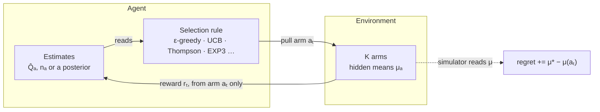
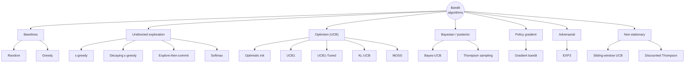

# Bandit Algorithm Arena

Seventeen multi-armed bandit algorithms, five environments, one simulation core, and an interactive dashboard for comparing them.

- **`src/mab.js`**: algorithms, environments and the benchmark runner. No dependencies; runs in the browser and in Node.
- **`dashboard/`**: the interactive web dashboard. Open `dashboard/index.html` in a browser. Nothing to install.
- **`scripts/benchmark.js`**: command-line benchmark that prints Markdown leaderboards and writes JSON.
- **`test/`**: unit and sanity tests (`npm test`).

## Quick start

```bash
# Dashboard: open the file directly, or serve the repo root
open dashboard/index.html               # macOS; or double-click it
npm run serve                           # then visit http://localhost:8000/dashboard/

# CLI benchmark (Node 18+)
node scripts/benchmark.js                                    # all algorithms x all environments
node scripts/benchmark.js --env gaussian --T 2000 --runs 500
node scripts/benchmark.js --algos ucb1,klucb,thompson --json results/run.json
npm test
```

## The dashboard

The dashboard runs every simulation in your browser and redraws as runs come in.

- **Settings rail**: pick the environment, number of arms K (2 to 50), horizon T (up to 10,000), number of runs to average, and the seed. Choose up to eight algorithms and edit their hyperparameters inline. Presets load common lineups.
- **Summary tiles**: lowest regret, best-arm rate, highest regret, and cheapest to run.
- **Learning curves**: cumulative regret with 95% confidence bands, best-arm rate, or reward per step. Optional log time axis, where logarithmic regret shows up as a straight line. Hover or use the arrow keys for a readout of every algorithm at that step.
- **Final regret**: a ranked bar chart with 95% confidence whiskers.
- **Where the pulls went**: a heatmap of the share of pulls each algorithm spent on each arm, with arms ranked best to worst.
- **Results table**: every number behind the charts, sortable.
- **Reference diagrams**: the agent/environment loop, and a side-by-side of how ε-greedy, UCB1 and Thompson sampling make different choices from the same evidence.
- **Catalog**: every algorithm with its selection rule, regret guarantee and defaults.

## How the comparison is made fair

- **Common random numbers.** Each run draws one bandit instance and pre-generates the full T x K reward table. Every algorithm in that run reads from the same table, so if two algorithms pull the same arm at the same step they get the same reward. This removes most of the noise between algorithms.
- **Lineup-independent seeds.** Each algorithm's random stream is seeded from `(seed, run, algorithm id)`, so its results do not change when you add or remove other algorithms.
- **Pseudo-regret.** Regret is `Σ (μ*ₜ − μ(aₜ))` using the true means, which has much lower variance than realized-reward regret. In the non-stationary environments, `μ*ₜ` is the best mean at step t (dynamic regret).
- **Reward scale.** Exploration bonuses are multiplied by `s = 1` for Bernoulli rewards and `s = √2` for unit-variance Gaussian rewards. EXP3 needs rewards in [0, 1], so Gaussian rewards are mapped with `clip((r + 4) / 8)`.

## The bandit loop



The algorithms differ only in the selection rule. Regret is computed by the simulator from the hidden means and is never visible to the agent.

## Algorithms



| Family | Algorithm | Selection rule | Regret guarantee | Defaults |
|---|---|---|---|---|
| Baseline | Random | uniform over arms | Θ(T) | |
| Baseline | Greedy | argmax Q̂ (Q̂ starts at 0) | Θ(T) | |
| Undirected | ε-greedy | random arm w.p. ε, else argmax Q̂ | Θ(T) | ε = 0.1 |
| Undirected | Decaying ε-greedy | εₜ = min(1, cK/t) | O(log T) if c fits the gap | c = 2 |
| Undirected | Explore-then-commit | m pulls per arm, then commit | O(T^⅔) untuned | m = 20 |
| Undirected | Softmax | P(a) ∝ exp(Q̂ₐ / τ) | Θ(T) for fixed τ | τ = 0.1 |
| Optimism | Optimistic initial values | greedy, Q̂ starts at Q₀, constant step α | Θ(T) | Q₀ = 5, α = 0.1 |
| Optimism | UCB1 | Q̂ + c·s·√(ln t / n) | O(Σ log T / Δ) | c = √2 |
| Optimism | UCB1-Tuned | variance-aware bonus | none proved; strong in practice | |
| Optimism | KL-UCB | max q with n·kl(Q̂, q) ≤ ln t + c ln ln t | asymptotically optimal | c = 0 |
| Optimism | MOSS | Q̂ + s·√(max(0, ln(T/(Kn))) / n) | O(√(KT)), minimax | |
| Bayesian | Bayes-UCB | (1 − 1/t) posterior quantile | asymptotically optimal (Bernoulli) | |
| Bayesian | Thompson sampling | argmax of one posterior draw per arm | asymptotically optimal | |
| Policy gradient | Gradient bandit | softmax over preferences, REINFORCE with baseline | none logarithmic | α = 0.1 |
| Adversarial | EXP3 | exponential weights, importance-weighted rewards | O(√(KT log K)) for any reward sequence | γ tuned to T |
| Non-stationary | Sliding-window UCB | UCB1 on the last τ plays | Õ(√(ΓT)) with Γ changes | τ = 500, c = 1 |
| Non-stationary | Discounted Thompson | counts decay by γ each step, then Thompson | none tight; strong empirically | γ = 0.99 |

Notes on the implementations:
- Bayesian methods use a Beta(1, 1) prior for Bernoulli arms and an N(0, 1) prior with known unit noise for Gaussian arms.
- Bayes-UCB on Bernoulli arms uses a normal approximation to the Beta quantile, which keeps it fast.
- UCB1-Tuned caps the variance term at ¼ for Bernoulli rewards (the published form) and leaves it uncapped for Gaussian rewards.

## Results

`npm run bench:readme` reproduces these: K = 10, T = 1,000, 200 runs, seed 7. Full tables are in [`results/benchmark.md`](results/benchmark.md) and curves in `results/benchmark.json`.

Mean cumulative regret at T (lower is better):

| Algorithm | Bernoulli | Close arms | Gaussian | Drifting | Abrupt |
|---|--:|--:|--:|--:|--:|
| Thompson sampling | **28.8** | 55.9 | 66.2 | 178 | 202 |
| KL-UCB | 31.8 | 60.4 | 90.4 | 148 | **107** |
| UCB1-Tuned | 34.4 | 51.7 | 101 | **147** | 129 |
| Bayes-UCB | 36.4 | 52.4 | 63.8 | 155 | 121 |
| MOSS | 47.2 | 55.6 | **60.1** | 172 | 143 |
| Decaying ε-greedy | 50.7 | **42.9** | 171 | 349 | 234 |
| ε-greedy | 69.0 | 48.4 | 241 | 368 | 241 |
| Softmax | 85.0 | 63.5 | 194 | 355 | 284 |
| Discounted Thompson | 85.1 | 72.2 | 220 | 220 | 141 |
| Explore-then-commit | 99.6 | 61.6 | 327 | 625 | 413 |
| Optimistic initial values | 113 | 66.7 | 243 | 286 | 142 |
| Sliding-window UCB | 125 | 71.1 | 151 | 185 | 147 |
| UCB1 | 130 | 71.5 | 149 | 161 | 153 |
| Gradient bandit | 137 | 69.9 | 186 | 363 | 335 |
| EXP3 | 184 | 72.5 | 1,026 | 1,199 | 345 |
| Greedy | 245 | 82.2 | 506 | 685 | 375 |
| Random | 419 | 81.3 | 1,508 | 1,805 | 414 |

What the numbers say:
- **Posterior and KL-based methods lead on stationary problems.** Thompson sampling, KL-UCB, Bayes-UCB and MOSS take the top spots wherever the means stay fixed and gaps are reasonable.
- **Plain UCB1 over-explores.** On the stationary environments it trails its tuned variants by a factor of 1.4 to 4, which is why the variance-aware and KL versions exist.
- **Close arms reward cheap exploration at short horizons.** With gaps of a few percentage points and only 1,000 steps, no method identifies the best arm reliably, and decaying ε-greedy edges ahead. Run longer horizons in the dashboard to watch the UCB and Bayesian methods catch up.
- **EXP3 pays for robustness.** Its guarantee holds against an adversary, and on benign stochastic problems that makes it slow, especially once Gaussian rewards are squeezed into [0, 1].
- **Forgetting matters once the horizon is long.** At T = 1,000 the drifting means have barely moved and stationary methods still do well. At T = 5,000 ([`results/nonstationary-T5000.md`](results/nonstationary-T5000.md)) Discounted Thompson (782) and Sliding-window UCB (857) cut regret roughly in half compared with UCB1 (1,635) and Thompson sampling (2,350). In the abrupt environment, redrawn means are far apart, so KL-UCB's slowly growing bonus is enough to re-explore and it stays on top.

## Adding an algorithm

Add an entry to `ALGORITHMS` in `src/mab.js`:

```js
{
  id: 'my-algo', name: 'My algorithm', family: 'optimism',
  params: [{ key: 'c', label: 'c', default: 1, min: 0, max: 5, step: 0.1 }],
  formula: 'argmaxₐ …', regret: 'O(log T)', idea: 'One sentence on why it works.',
  create(K, { T, env, params, rng }) {
    return {
      select(t) { /* return an arm in [0, K) */ },
      update(arm, reward, t) { /* learn */ },
    };
  },
}
```

It appears in the dashboard, the catalog, the CLI benchmark and the tests automatically.
