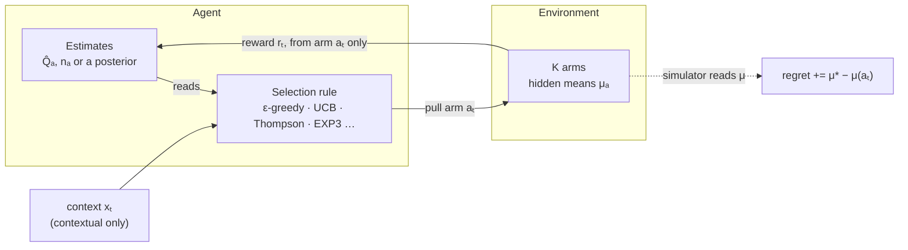

# Bandit Algorithm Arena

Forty-five multi-armed bandit algorithms in eleven families, six environments, one simulation core, and an interactive dashboard for comparing them.

- **`src/mab.js`**: algorithms, environments and the benchmark runner. No dependencies; runs in the browser and in Node.
- **`dashboard/`**: the interactive web dashboard. Open `dashboard/index.html` in a browser. Nothing to install.
- **`scripts/benchmark.js`**: command-line benchmark that prints Markdown leaderboards and writes JSON.
- **`test/`**: unit and sanity tests (`npm test`).

## Quick start

```bash
# Dashboard: open the file directly, or serve the repo root
open dashboard/index.html               # macOS; or double-click it
npm run serve                           # then visit http://localhost:8000/dashboard/

# CLI benchmark (Node 18+)
node scripts/benchmark.js                                    # all algorithms x all environments
node scripts/benchmark.js --env gaussian --T 2000 --runs 500
node scripts/benchmark.js --algos ucb1,klucb,thompson,linucb --json results/run.json
npm test
```

## The dashboard

The dashboard runs every simulation in your browser and redraws as runs come in.

- **Settings rail**: pick the environment, number of arms K (2 to 50), horizon T (up to 10,000), number of runs to average, and the seed. Choose up to eight algorithms at a time, filter the list by name, and edit hyperparameters inline. Presets load common lineups: UCB variants, KL and divergence methods, Bayesian decision rules, elimination, learning automata, adversarial, tracking change, and contextual.
- **Summary tiles**: lowest regret, best-arm rate, highest regret, and cheapest to run.
- **Learning curves**: cumulative regret with 95% confidence bands, best-arm rate, or reward per step. Optional log time axis, where logarithmic regret shows up as a straight line. Hover or use the arrow keys for a readout of every algorithm at that step.
- **Final regret**: a ranked bar chart with 95% confidence whiskers.
- **Where the pulls went**: a heatmap of the share of pulls each algorithm spent on each arm, with arms ranked best to worst.
- **Results table**: every number behind the charts, sortable.
- **Reference diagrams**: the agent/environment loop, and a side-by-side of how ε-greedy, UCB1 and Thompson sampling make different choices from the same evidence.
- **Catalog**: every algorithm with its selection rule, regret guarantee and defaults.

## Environments

| Environment | Rewards | What it tests |
|---|---|---|
| Bernoulli, uniform means | 0/1 with μ ~ U(0, 1) | The standard case: large, varied gaps |
| Bernoulli, close arms | best 0.55, rest U(0.40, 0.52) | Small gaps, where exploration is expensive |
| Gaussian testbed | N(μ, 1), μ ~ N(0, 1) | Sutton & Barto's 10-armed testbed |
| Gaussian, drifting means | every μ random-walks by N(0, 0.03²) per step | Slow change |
| Bernoulli, abrupt changes | all μ redrawn at four change points | Sudden change |
| Linear contextual | N(θₐ·x, 1), context x = (1, z₁…z₄) shown each round | Whether an algorithm can use side information |

## How the comparison is made fair

- **Common random numbers.** Each run draws one bandit instance and pre-generates the full T x K reward table (and the context sequence). Every algorithm in that run reads from the same table, so if two algorithms pull the same arm at the same step they get the same reward.
- **Lineup-independent seeds.** Each algorithm's random stream is seeded from `(seed, run, algorithm id)`, so its results do not change when you add or remove other algorithms.
- **Pseudo-regret.** Regret is `Σ (μ*ₜ − μ(aₜ))` using the true means, which has much lower variance than realized-reward regret. Where means change over time or depend on the context, `μ*ₜ` is the best mean at step t (dynamic regret).
- **Reward scale.** Exploration bonuses are multiplied by `s = 1` for Bernoulli rewards and `s = √2` for unit-variance Gaussian rewards. Adversarial methods and learning automata need rewards in [0, 1], so Gaussian rewards are mapped with `clip((r + 4) / 8)`.
- **Context.** Every algorithm receives the context vector each round; only contextual algorithms use it. In the context-free environments the context is the constant `(1)`, so LinUCB becomes a ridge-regression UCB with a fixed confidence multiplier.

## The bandit loop



The algorithms differ only in the selection rule. Regret is computed by the simulator from the hidden means and is never visible to the agent.

## Algorithms

```mermaid
flowchart LR
  root(("Bandit<br/>algorithms"))
  root --> F0["Baselines"]
  F0 --> F0A0["Random"] & F0A1["Greedy"]
  root --> F1["Undirected exploration"]
  F1 --> F1A0["ε-greedy"] & F1A1["Decaying ε-greedy"] & F1A2["Explore-then-commit"] & F1A3["Softmax (Boltzmann)"] & F1A4["Annealed softmax"]
  root --> F2["Optimism in the face of uncertainty"]
  F2 --> F2A0["Optimistic initial values"] & F2A1["UCB1"] & F2A2["UCB1-Tuned"] & F2A3["KL-UCB"] & F2A4["MOSS"] & F2A5["UCB2"] & F2A6["UCB-V"] & F2A7["UCB1-Normal"] & F2A8["KL-UCB+"] & F2A9["KL-UCB++"] & F2A10["MOSS-anytime"]
  root --> F3["Elimination"]
  F3 --> F3A0["Improved UCB"] & F3A1["Successive elimination"] & F3A2["Sequential halving + commit"]
  root --> F4["Minimum empirical divergence"]
  F4 --> F4A0["IMED"]
  root --> F5["Bayesian / posterior"]
  F5 --> F5A0["Bayes-UCB"] & F5A1["Thompson sampling"] & F5A2["Gittins index (approx.)"] & F5A3["Knowledge gradient"] & F5A4["Information-directed sampling"]
  root --> F6["Randomized perturbation"]
  F6 --> F6A0["Perturbed-history exploration"] & F6A1["Boltzmann–Gumbel"]
  root --> F7["Policy gradient & learning automata"]
  F7 --> F7A0["Gradient bandit"] & F7A1["Pursuit"] & F7A2["Linear reward-inaction"] & F7A3["Reinforcement comparison"]
  root --> F8["Adversarial"]
  F8 --> F8A0["EXP3"] & F8A1["EXP3-IX"] & F8A2["EXP3.P"] & F8A3["Tsallis-INF"]
  root --> F9["Non-stationary"]
  F9 --> F9A0["Sliding-window UCB"] & F9A1["Discounted Thompson"] & F9A2["ε-greedy, constant step"] & F9A3["Discounted UCB"] & F9A4["Monitored UCB"] & F9A5["EXP3.S"] & F9A6["Rexp3"]
  root --> F10["Contextual"]
  F10 --> F10A0["LinUCB"]
```



| Family | Algorithm | Selection rule | Regret guarantee | Defaults |
|---|---|---|---|---|
| Baselines | Random | aₜ ~ Uniform{1, …, K} | Θ(T) |  |
| Baselines | Greedy | aₜ = argmaxₐ Q̂ₐ   (Q̂ starts at 0) | Θ(T) |  |
| Undirected exploration | ε-greedy | random arm w.p. ε, else argmaxₐ Q̂ₐ | Θ(T)  (keeps exploring at rate ε) | ε = 0.1 |
| Undirected exploration | Decaying ε-greedy | εₜ = min(1, c·K / t) | O(log T)  with c tuned to the gap | c = 2 |
| Undirected exploration | Explore-then-commit | round-robin for m·K steps, then argmaxₐ Q̂ₐ forever | O(T^⅔)  untuned; O(log T) if m knows the gap | m = 20 |
| Undirected exploration | Softmax (Boltzmann) | P(a) ∝ exp(Q̂ₐ / τ) | Θ(T)  for fixed τ | τ = 0.1 |
| Undirected exploration | Annealed softmax | P(a) ∝ exp(Q̂ₐ / τₜ),   τₜ = τ₀ / ln(t + 1) | Depends on the schedule; no general log T bound | τ₀ = 1 |
| Optimism in the face of uncertainty | Optimistic initial values | Q̂ₐ ← Q̂ₐ + α(r − Q̂ₐ),  Q̂ starts at Q₀;  greedy | Θ(T)  (exploration only at the start) | Q₀ = 5, α = 0.1 |
| Optimism in the face of uncertainty | UCB1 | argmaxₐ  Q̂ₐ + c·s·√(ln t / nₐ) | O(Σ log T / Δₐ) | c = 1.414 |
| Optimism in the face of uncertainty | UCB1-Tuned | argmaxₐ  Q̂ₐ + √(ln t / nₐ · min(¼, Vₐ)),  Vₐ = σ̂ₐ² + √(2 ln t / nₐ) | No proof; strong in practice |  |
| Optimism in the face of uncertainty | KL-UCB | max { q : nₐ·kl(Q̂ₐ, q) ≤ ln t + c ln ln t } | Asymptotically optimal (matches Lai–Robbins) | c = 0 |
| Optimism in the face of uncertainty | MOSS | argmaxₐ  Q̂ₐ + s·√(max(0, ln(T / (K·nₐ))) / nₐ) | O(√(KT))  minimax optimal; needs T |  |
| Optimism in the face of uncertainty | UCB2 | argmaxₐ Q̂ₐ + √((1+α) ln(e·t / τ(rₐ)) / 2τ(rₐ)),  played for an epoch,  τ(r) = ⌈(1+α)^r⌉ | O(Σ log T / Δₐ), leading constant near optimal for small α | α = 0.1 |
| Optimism in the face of uncertainty | UCB-V | argmaxₐ Q̂ₐ + √(2 V̂ₐ ζ ln t / nₐ) + 3bζ ln t / nₐ,   ζ = 1.2 | O(Σ (σₐ²/Δₐ + b) log T) |  |
| Optimism in the face of uncertainty | UCB1-Normal | play any arm with nₐ < ⌈8 ln t⌉;  else argmaxₐ Q̂ₐ + √(16 σ̂ₐ² ln(t−1) / nₐ) | O(Σ σ² log T / Δₐ) for Gaussian rewards |  |
| Optimism in the face of uncertainty | KL-UCB+ | max { q : nₐ·kl(Q̂ₐ, q) ≤ ln(t / nₐ) } | Asymptotically optimal; usually below KL-UCB in practice |  |
| Optimism in the face of uncertainty | KL-UCB++ | max { q : nₐ·kl(Q̂ₐ, q) ≤ ln₊( T/(K nₐ) · (ln₊²(T/(K nₐ)) + 1) ) } | Asymptotically optimal and minimax optimal; needs T |  |
| Optimism in the face of uncertainty | MOSS-anytime | argmaxₐ Q̂ₐ + s·√( (1+α)/2 · ln₊(t / (K nₐ)) / nₐ ) | O(√(KT)) without knowing T | α = 1.35 |
| Elimination | Improved UCB | phase m: Δ̃ = 2⁻ᵐ; sample survivors to ⌈2 ln(TΔ̃²)/Δ̃²⌉; drop arms whose UCB < best LCB | O(Σ log(TΔₐ²) / Δₐ); needs T |  |
| Elimination | Successive elimination | round-robin over survivors;  drop a if Q̂ₐ + w < max Q̂ − w,   w = s·√(2 ln T / r) | O(Σ log T / Δₐ);  O(√(KT log T)) worst case |  |
| Elimination | Sequential halving + commit | ⌈log₂K⌉ rounds, each splits the budget evenly over survivors and keeps the top half; then commit | A best-arm identification method: cost ≈ budget, then a commit that may be wrong | budget = 0.2 |
| Minimum empirical divergence | IMED | argminₐ  nₐ·KL(Q̂ₐ, max Q̂) + ln nₐ | Asymptotically optimal (Honda & Takemura) |  |
| Bayesian / posterior | Bayes-UCB | argmaxₐ  Quantile(1 − 1/t, posteriorₐ) | Asymptotically optimal (Bernoulli) |  |
| Bayesian / posterior | Thompson sampling | θₐ ~ posteriorₐ,   aₜ = argmaxₐ θₐ | Asymptotically optimal (Bernoulli, Gaussian) |  |
| Bayesian / posterior | Gittins index (approx.) | argmaxₐ  μₐ + σₐ·ψ(σₐ² / (σ² ln(1/γ)))   (Brezzi–Lai approximation) | Exact index is Bayes-optimal for discounted reward; no frequentist bound | γ = 0 |
| Bayesian / posterior | Knowledge gradient | argmaxₐ  μₐ + (T − t)·σ̃ₐ f(−\|μₐ − maxᵦ≠ₐ μᵦ\| / σ̃ₐ),   f(z) = zΦ(z) + φ(z) | No regret bound; a one-step lookahead policy |  |
| Bayesian / posterior | Information-directed sampling | π = argmin over distributions of  (E_π Δ)² / E_π g,   Δ = regret, g = information gain about a* | Bayesian regret O(√(KT log K)) | posterior = 50 |
| Randomized perturbation | Perturbed-history exploration | argmaxₐ (Σ rewards + Σ ⌈a·nₐ⌉ pseudo-rewards) / (nₐ + ⌈a·nₐ⌉) | O(Σ log T / Δₐ) for Bernoulli rewards with a > 1 | a = 1.1 |
| Randomized perturbation | Boltzmann–Gumbel | argmaxₐ  Q̂ₐ + C·s·Zₐ / √nₐ,   Zₐ ~ Gumbel(0, 1) | O(Σ log² T / Δₐ) | C = 0.2 |
| Policy gradient & learning automata | Gradient bandit | Hₐ ← Hₐ + α(r − r̄)(𝟙[a = aₜ] − πₐ),  π = softmax(H) | No logarithmic guarantee | α = 0.1 |
| Policy gradient & learning automata | Pursuit | π ← π + β(e_greedy − π);   sample aₜ ~ π | ε-optimal for small β; no log T bound | β = 0.01 |
| Policy gradient & learning automata | Linear reward-inaction | on reward r̃ ∈ [0, 1]:  π ← π + λ r̃ (e_aₜ − π);   no change on failure | ε-optimal for small λ; can lock onto a wrong arm | λ = 0.01 |
| Policy gradient & learning automata | Reinforcement comparison | h_aₜ ← h_aₜ + β(r − r̄),   r̄ ← r̄ + α(r − r̄),   π = softmax(h) | No regret bound | β = 0.1, α = 0.1 |
| Adversarial | EXP3 | πₐ = (1−γ)·wₐ/Σw + γ/K,   wₐ ← wₐ·exp(γ r̃ / (K πₐ)) | O(√(KT log K))  against any reward sequence | γ = 0 |
| Adversarial | EXP3-IX | π ∝ exp(−η L̂),   L̂ₐ += ℓ / (πₐ + γ),   η = √(2 ln K / KT),  γ = η/2 | O(√(KT log K)) with high probability |  |
| Adversarial | EXP3.P | wᵢ ← wᵢ·exp(γ/3K · (x̂ᵢ + α / (πᵢ√(KT)))),   π = (1−γ)w/Σw + γ/K | O(√(KT log(K/δ))) with probability 1 − δ |  |
| Adversarial | Tsallis-INF | πₐ = 4 / (ηₜ(L̂ₐ − x))²,  x normalizes π,  ηₜ = 2/√t | Best of both worlds: O(√(KT)) adversarial, O(Σ log T / Δₐ) stochastic |  |
| Non-stationary | Sliding-window UCB | UCB1 computed on the last τ plays only | Õ(√(ΓT))  with Γ change points | τ = 500, c = 1 |
| Non-stationary | Discounted Thompson | all counts ← γ·counts each step;  then Thompson sampling | No tight bound; strong empirically | γ = 0.99 |
| Non-stationary | ε-greedy, constant step | Q̂ₐ ← Q̂ₐ + α(r − Q̂ₐ);  random arm w.p. ε, else argmax Q̂ | Θ(T); tracks drift | ε = 0.1, α = 0.1 |
| Non-stationary | Discounted UCB | argmaxₐ  X̄ₐ(γ) + c·s·√(ln nₜ(γ) / Nₐ(γ)),  all statistics discounted by γ | Õ(√(ΓT)) with Γ change points | γ = 0.99, c = 1 |
| Non-stationary | Monitored UCB | UCB1 since the last reset;  reset all arms when \|Σ second half − Σ first half\| of an arm's last w rewards > b | O(√(ΓKT log T)) with Γ change points | w = 100, γ = 0.05 |
| Non-stationary | EXP3.S | wᵢ ← wᵢ·exp(γ x̂ᵢ / K) + (eα/K)·Σⱼ wⱼ,   α = 1/T | O(√(S K T log(KT))) against the best sequence with S switches |  |
| Non-stationary | Rexp3 | run EXP3 (γ tuned to the batch) and restart it every Δ steps | O((K log K)^⅓ V^⅓ T^⅔) with variation budget V | restart = 250 |
| Contextual | LinUCB | argmaxₐ  θ̂ₐ·xₜ + α√(xₜᵀ Aₐ⁻¹ xₜ),   Aₐ = I + Σ x xᵀ,  θ̂ₐ = Aₐ⁻¹ Σ r x | Õ(d√(KT)) for linear rewards | α = 1 |

Notes on the implementations:
- Bayesian methods use a Beta(1, 1) prior for Bernoulli arms and an N(0, 1) prior with known unit noise for Gaussian arms.
- Bayes-UCB on Bernoulli arms uses a normal approximation to the Beta quantile, which keeps it fast.
- The Gittins index uses Brezzi & Lai's closed-form approximation with discount γ = 1 − 1/T. Knowledge gradient is the online variant of Ryzhov, Powell & Frazier. Information-directed sampling is the variance-based version, estimated from posterior samples and mixing at most two arms; at about 90 ms per 1,000-step run it is by far the slowest.
- UCB1-Tuned caps the variance term at ¼ for Bernoulli rewards (the published form) and leaves it uncapped for Gaussian rewards.
- LinUCB is the disjoint model of Li et al. (2010): one ridge regression per arm, updated with Sherman–Morrison.
- Not included: methods that need structure these environments don't have, such as combinatorial, dueling, infinitely-many-armed, Lipschitz and Gaussian-process bandits.

## Results

`npm run bench:readme` reproduces these: K = 10, T = 1,000, 200 runs, seed 7. Full per-environment tables are in [`results/benchmark.md`](results/benchmark.md) and curves in `results/benchmark.json`.

Mean cumulative regret at T (lower is better; bold marks each column's best). Rows are sorted by average rank across the six environments.

| Algorithm | Bernoulli | Close arms | Gaussian | Drifting | Abrupt | Contextual | Avg. rank |
|---|--:|--:|--:|--:|--:|--:|--:|
| Gittins index (approx.) | 20.3 | **42.8** | **44.5** | 178 | 142 | 956 | 4.8 |
| Bayes-UCB | 36.4 | 52.4 | 63.8 | 155 | 121 | 979 | 7.3 |
| Information-directed sampling | 20.1 | 46.7 | 53.6 | 180 | 168 | 968 | 7.3 |
| KL-UCB+ | 30.7 | 57.0 | 80.0 | 151 | 115 | 988 | 8.3 |
| Knowledge gradient | **17.4** | 44.2 | 47.8 | 266 | 209 | 971 | 8.5 |
| IMED | 31.8 | 56.6 | 83.9 | 155 | 116 | 990 | 9.2 |
| MOSS-anytime | 50.0 | 56.1 | 63.9 | 162 | 132 | 976 | 9.3 |
| UCB1-Tuned | 34.4 | 51.7 | 101 | **147** | 129 | 1,020 | 9.5 |
| KL-UCB | 31.8 | 60.4 | 90.4 | 148 | **107** | 1,000 | 9.5 |
| MOSS | 47.2 | 55.6 | 60.1 | 172 | 143 | 978 | 9.5 |
| KL-UCB++ | 32.0 | 52.5 | 84.1 | 180 | 128 | 983 | 9.7 |
| Boltzmann–Gumbel | 33.6 | 48.1 | 48.0 | 181 | 201 | 981 | 10.0 |
| LinUCB | 18.2 | 44.1 | 172 | 309 | 162 | **170** | 10.7 |
| Thompson sampling | 28.8 | 55.9 | 66.2 | 178 | 202 | 985 | 11.0 |
| Perturbed-history exploration | 38.7 | 56.6 | 78.9 | 185 | 215 | 989 | 14.7 |
| Decaying ε-greedy | 50.7 | 42.9 | 171 | 349 | 234 | 1,026 | 17.2 |
| UCB2 | 109 | 65.8 | 105 | 177 | 181 | 1,027 | 18.2 |
| UCB1 | 130 | 71.5 | 149 | 161 | 153 | 1,061 | 20.3 |
| Pursuit | 56.8 | 47.0 | 187 | 391 | 310 | 1,022 | 21.0 |
| Sliding-window UCB | 125 | 71.1 | 151 | 185 | 147 | 1,061 | 21.3 |
| ε-greedy | 69.0 | 48.4 | 241 | 368 | 241 | 1,043 | 21.5 |
| Softmax (Boltzmann) | 85.0 | 63.5 | 194 | 355 | 284 | 1,020 | 22.8 |
| Annealed softmax | 108 | 70.2 | 126 | 225 | 292 | 1,056 | 23.2 |
| Optimistic initial values | 113 | 66.7 | 243 | 286 | 142 | 1,144 | 23.3 |
| Discounted Thompson | 85.1 | 72.2 | 220 | 220 | 141 | 1,163 | 23.5 |
| Sequential halving + commit | 51.4 | 53.3 | 187 | 426 | 369 | 1,035 | 24.2 |
| Monitored UCB | 131 | 71.8 | 184 | 214 | 157 | 1,080 | 24.2 |
| ε-greedy, constant step | 126 | 63.0 | 292 | 366 | 209 | 1,069 | 25.7 |
| Reinforcement comparison | 132 | 70.9 | 170 | 322 | 331 | 1,053 | 26.7 |
| Gradient bandit | 137 | 69.9 | 186 | 363 | 335 | 1,045 | 27.5 |
| Tsallis-INF | 84.7 | 65.4 | 644 | 757 | 272 | 1,389 | 29.8 |
| Explore-then-commit | 99.6 | 61.6 | 327 | 625 | 413 | 1,127 | 30.0 |
| Discounted UCB | 238 | 76.4 | 422 | 408 | 241 | 1,276 | 33.0 |
| UCB-V | 231 | 76.0 | 436 | 414 | 277 | 1,307 | 33.5 |
| EXP3-IX | 128 | 70.8 | 883 | 1,021 | 309 | 1,479 | 34.2 |
| Improved UCB | 283 | 81.2 | 371 | 528 | 410 | 1,236 | 37.2 |
| Greedy | 245 | 82.2 | 506 | 685 | 375 | 1,145 | 37.5 |
| UCB1-Normal | 291 | 74.0 | 877 | 987 | 336 | 1,417 | 37.8 |
| Linear reward-inaction | 169 | 71.6 | 1,032 | 1,202 | 350 | 1,523 | 37.8 |
| EXP3 | 184 | 72.5 | 1,026 | 1,199 | 345 | 1,514 | 37.8 |
| EXP3.S | 232 | 74.1 | 1,077 | 1,255 | 308 | 1,524 | 38.3 |
| Successive elimination | 396 | 81.2 | 598 | 693 | 414 | 1,461 | 40.2 |
| Rexp3 | 282 | 77.1 | 1,273 | 1,481 | 322 | 1,581 | 40.3 |
| EXP3.P | 334 | 79.3 | 1,387 | 1,639 | 378 | 1,619 | 42.8 |
| Random | 419 | 81.3 | 1,508 | 1,805 | 414 | 1,649 | 44.8 |

What the numbers say:
- **Bayesian lookahead leads on stationary problems.** The approximate Gittins index has the best average rank. Knowledge gradient (17.4) and information-directed sampling (20.1) beat Thompson sampling (28.8) on Bernoulli arms, though IDS costs about 50 times more compute per step.
- **KL-based indices sit close behind.** KL-UCB+, IMED and KL-UCB++ land within a few points of Thompson sampling and beat UCB1 by a factor of 2 to 4 on Bernoulli arms.
- **Only LinUCB uses the context.** On the contextual environment its regret is 170. Every context-free method is above 950, because averaged over contexts the arms look nearly alike.
- **Conservative confidence bounds need long horizons.** Successive elimination, Improved UCB, UCB-V and UCB1-Normal behave close to round-robin at T = 1,000, because their confidence widths have not yet shrunk enough to rule arms out.
- **Adversarial guarantees cost speed on stochastic rewards.** Tsallis-INF is the best of the adversarial family, as its best-of-both-worlds guarantee predicts. EXP3, EXP3.P and EXP3.S learn slowly, especially once Gaussian rewards are squeezed into [0, 1].
- **Forgetting matters once the horizon is long.** At T = 1,000 the drifting means have barely moved and stationary methods still do well. At T = 5,000 ([`results/nonstationary-T5000.md`](results/nonstationary-T5000.md)) Discounted Thompson (782) and Sliding-window UCB (857) cut regret roughly in half compared with UCB1 (1,635) and Thompson sampling (2,350). In the abrupt environment the redrawn means are far apart, so KL-UCB's slowly growing bonus is enough to re-explore and it stays on top.

## Adding an algorithm

Add an entry to `ALGORITHMS` in `src/mab.js`:

```js
{
  id: 'my-algo', name: 'My algorithm', family: 'optimism',
  params: [{ key: 'c', label: 'c', default: 1, min: 0, max: 5, step: 0.1 }],
  formula: 'argmaxₐ …', regret: 'O(log T)', idea: 'One sentence on why it works.',
  create(K, { T, env, params, rng, d }) {
    return {
      select(t, x) { /* x: context vector of length d; return an arm in [0, K) */ },
      update(arm, reward, t) { /* learn */ },
    };
  },
}
```

It appears in the dashboard, the catalog, the CLI benchmark and the tests automatically.
