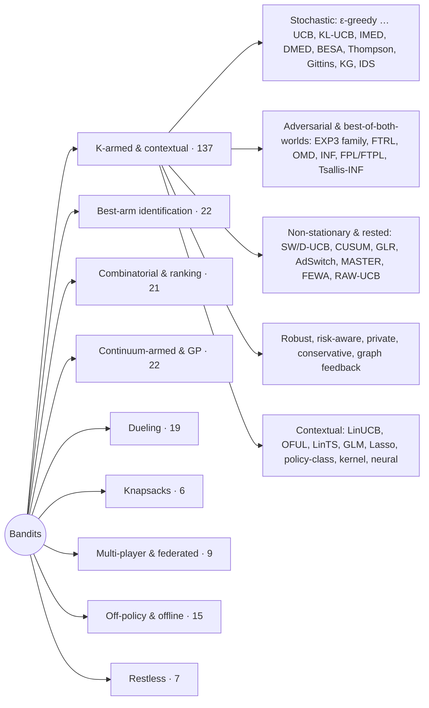

# Bandit Algorithm Arena

258 multi-armed bandit algorithms across nine problem settings, with one simulation core, a command-line benchmark and an interactive dashboard for comparing them. Everything is plain JavaScript with no dependencies and runs in the browser or in Node.

- **[Full algorithm catalog](docs/ALGORITHMS.md)**: every algorithm with its rule, guarantee, defaults and implementation notes.
- **[Benchmark results](results/README.md)**: the leaders in every environment; full tables in `results/<setting>.md`.
- **[Architecture](docs/ARCHITECTURE.md)**: how settings, environments and algorithms plug in.

## Quick start

```bash
# Dashboard: open the file directly, or serve the repo root
open dashboard/index.html               # macOS; or double-click it
npm run serve                           # then visit http://localhost:8000/dashboard/

# CLI benchmark (Node 18+)
node scripts/benchmark.js --list                                  # settings, environments, algorithm ids
node scripts/benchmark.js --env gaussian --T 2000 --runs 500      # K-armed arena
node scripts/benchmark.js --setting dueling --runs 50
node scripts/benchmark.js --setting bai --set delta=0.01 --algos tas-d,ttts,lucb,uniform
npm test                                                          # 147 tests
```

## Settings

| Setting | Each round the learner… | Measured by | Algorithms | Environments |
|---|---|---|---:|---:|
| **K-armed & contextual** | pulls one of K arms (optionally seeing a context) and sees only its reward | cumulative regret | 137 | 24 |
| **Best-arm identification** | samples an arm, aiming to name the best one (or the top m) | samples to stop at confidence 1 − δ; error rate for a budget | 22 | 6 |
| **Combinatorial & ranking** | picks a set or ranked list of m items; sees per-item, cascade, click-model or total feedback | cumulative regret | 21 | 7 |
| **Continuum-armed & GP** | picks a point in [0,1] or [0,1]² | cumulative and simple regret, unsafe evaluations | 22 | 7 |
| **Dueling** | picks two arms and learns only which one won | strong and weak regret | 19 | 5 |
| **Bandits with knapsacks** | pulls an arm that also uses up limited resources | regret against the LP optimum | 6 | 4 |
| **Multi-player & federated** | several players pull arms at once; collisions pay nothing (or agents share statistics) | system regret, collisions | 9 | 4 |
| **Off-policy & offline** | learns from logged data only | estimation error, or suboptimality of the learned policy | 15 | 4 |
| **Restless** | pulls M of N Markov arms that change state whether pulled or not | regret against the Whittle-index policy | 7 | 3 |



## The dashboard

`dashboard/index.html` runs every simulation in the browser and redraws as runs come in.

- **Setting tabs** switch between the nine problem settings. Each tab remembers its own lineup and controls, and the address bar keeps the tab (`#dueling`, `#bai`, …).
- **Settings rail**: environment, the setting's own controls (arms, horizon, budget, list size, δ, number of players, …), runs and seed. Pick up to eight algorithms at a time, filter the list, edit hyperparameters inline, or load a preset lineup.
- **Summary tiles**, **learning curves** (one tab per measure, 95% confidence bands, optional log x-axis, keyboard-accessible readout), a **ranked bar chart** of the final measure, a **pull heatmap** where it applies, and a sortable **results table**.
- **Reference diagrams** of the bandit loop and of how ε-greedy, UCB1 and Thompson sampling decide differently from the same evidence, and a **catalog** of every algorithm in the current setting.

## How the comparisons are kept fair

- **Common random numbers.** Each run draws one instance and pre-generates its randomness (reward tables, duel outcomes, click tables, noise streams, logged data). Every algorithm in that run reads the same draws.
- **Lineup-independent seeds.** Each algorithm's own randomness is seeded from `(seed, run, algorithm id)`, so its results do not change when you add or remove others. Tests check this in every setting.
- **Pseudo-regret.** Regret uses expected rewards, not realized ones. In changing environments the benchmark is the best arm at each step; for rested arms it is the better of the greedy oracle and the best fixed arm; for knapsacks it is the LP relaxation; for restless bandits it is the Whittle policy with the true parameters.
- **Honest labels.** Where a published method had to be simplified to run here (an approximate LP, a diagonal Gram matrix, a cheaper stopping test), its description in the dashboard and the catalog says so.

## What the results show

Numbers below are from [`results/`](results/README.md) (seed 7). Lower is better unless stated.

**K-armed & contextual** (10 arms, 1,000 steps, 30 runs; [all 24 environments](results/README.md#k-armed--contextual))
- **Stationary arms:** the Bayesian look-ahead methods lead. On Bernoulli arms KG(\*) scores 18.9, Knowledge gradient 20.8, IDS 23.2 and the approximate Gittins index 25.8; Thompson sampling (31.2), BESA (30.0), KL-UCB+ (33.3) and IMED (35.4) follow. Plain UCB1 (133) trails the leaders by 4–7×. LinUCB with only a constant feature comes second (20.6): it behaves like a ridge-regression UCB with a fixed bonus, which happens to suit this horizon.
- **Contextual environments:** context-aware methods win by a wide margin. On the shared-θ linear bandit GLM-UCB scores 43, LinTS 62 and OFUL 85, against about 1,540 for Thompson sampling and UCB1. On the nonlinear environment KernelUCB (410), NeuralUCB (412) and NeuralTS (441) beat LinUCB (510). Lasso Bandit wins the sparse environment and dLinUCB the switching-θ one.
- **Adversarial environments:** on the switching trap OMD (111) and FTPL-Fréchet (118) beat UCB1 (164), but a constant-step ε-greedy (95) does best of all, because it forgets old rewards. With corrupted early rounds, stochastic methods like MOSS (104) and Thompson sampling (154) still beat EXP3 (246).
- **Changing and rested arms:** RAW-UCB (7.4) and FEWA (11.6) dominate when arms rot with use, against 54 for UCB1. When only the best arm breaks, RAW-UCB (93) and GLR-klUCB (116) beat UCB1 (184), while CUSUM-UCB (181) only matches it at this horizon. On slowly drifting means, forgetting does not pay off yet at 1,000 steps (UCB1 136, sliding-window UCB 186); at 5,000 steps it does ([`results/nonstationary-T5000.md`](results/nonstationary-T5000.md)).
- **Heavy tails:** APE² (122) beats UCB1 (210). In this 30-run benchmark the Catoni (220) and median-of-means (206) UCBs only match UCB1; their builder's 200-run check had them ahead, so the gap is within the noise of heavy-tailed rewards. Bayesian methods do best here despite the wrong noise model (Gittins 84, Thompson sampling 106).
- **Side observations:** methods that use the extra feedback gain a lot: TS-N 18.2 against 28.6 for Thompson sampling, UCB-N 71 against 136 for UCB1.

**Best-arm identification** (8 arms, δ = 0.05): the top-two methods (TTUCB, T3C, TTTS), Track-and-Stop, FWS and GIFA stop after about 330–450 samples, about half of uniform sampling with the same stopping test. LUCB1, UGapE and successive elimination often hit the 5,000-sample cap because their published stopping rules are conservative.

**Combinatorial & ranking** (16 items, lists of 4): CTS, ESCB and CascadeLinTS (which falls back to per-item Thompson sampling when items have no features) lead on semi-bandit feedback; ESCB leads on the cascade and dependent-click models; PBM-PIE wins on the position-based model; and the linear cascade methods win with item features. The full-bandit adversarial instance does not defeat stochastic methods: CUCB (203) beats ComBand (716).

**Continuum-armed & GP** (500 steps): GP-UCB, BKB, StageOpt and the tree methods (UCT, DOO, HOO) lead on smooth, multimodal and 2-D functions; SafeOpt and StageOpt make almost no unsafe evaluations (0–3 against 255 for uniform); SOO is best at finding a narrow needle next to a broad decoy; Contextual Zooming is the only method that adapts to the context (176 against about 300). The gradient methods (FKM, BGD, SCR) make progress only on the convex function, and even there the tree methods are ahead.

**Dueling** (8 arms, 2,000 duels): Double Thompson Sampling and the RMED family lead when a Condorcet winner exists; DTS, CCB and CW-RMED handle Copeland winners; only the Borda method finds a Borda winner that differs from the Condorcet winner. BTM's published confidence radius never eliminates an arm at this horizon.

**Knapsacks**: UCB-BwK and CBwK get closest to the LP optimum, while cost-blind UCB1 runs out of budget early. **Multi-player**: DPE and MCTopM have the lowest regret and few collisions; SIC-MMAB's collisions are almost all deliberate signals. **Off-policy**: DR beats IPS with a good reward model, IPS stays unbiased but noisy under low overlap, and pessimistic learners (PEVI, LinLCB, NeuralLCB) beat their greedy versions when coverage is poor. **Restless**: UCWhittle reaches about 97% of the oracle Whittle policy's reward on the indexable instance; on heterogeneous arms Thompson-sampling Whittle does better.

## Names from the request that are interpreted or not implemented

- **POOO** is implemented as **POO** (Grill, Valko & Munos 2015).
- **CExp3 / ComBand** are one algorithm (ComBand).
- **Borda-UCB / SECS** is implemented as **Borda successive elimination**, without SECS's sparsity tricks.
- **Kernelized BCO** is a simplified kernel-weighted exponential-weights method; the Bubeck–Lee–Eldan algorithm is impractical to run.
- **ESC** is implemented as **ESCB** (Combes et al. 2015).
- Not implemented because no distinct published algorithm by that name could be identified: **BROAD-Adversarial** (BROAD-OMD is included), **LCVaR-UCB**, **Safe-UCB** (Conservative UCB is included) and **Pac-Bandit**.

## Project layout

```
src/mab.js            core: RNG, helpers, K-armed & contextual arena, registries
src/algos/*.js        arena add-ons: classical, adversarial, non-stationary, robust, linear, policy & neural
src/settings/*.js     settings: bai, combinatorial, continuum, dueling, knapsack, multiplayer, offpolicy, restless
src/index.js          Node entry point (loads everything)
dashboard/            the web UI (index.html, app.js)
scripts/benchmark.js  CLI benchmark for any setting
scripts/catalog.js    regenerates docs/ALGORITHMS.md and results/README.md
scripts/build-dashboard.js  syncs the dashboard's script tags; --single writes a one-file copy
test/*.test.js        node --test suites
```

To add an algorithm or a whole setting, follow [docs/ARCHITECTURE.md](docs/ARCHITECTURE.md), then run `npm run build`, `npm test` and `node scripts/catalog.js`.
